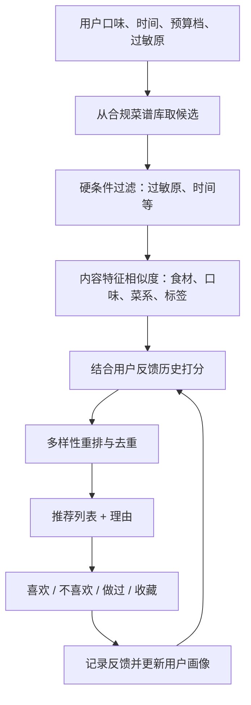

# TasteAI｜个性化美食推荐系统——独立开发执行手册

> 版本：v1.0｜日期：2026-11-20｜开发方式：**单人开发，国际版 Qoder 辅助**｜交付对象：Qoder IDE
>
> **一句话定位**：解决「今天吃什么」的选择困难。用户通过口味、时间、预算和喜好反馈，获得真正可解释、能持续改善的个性化菜谱推荐。
>
> **重要：这是一份产品 + UI + 技术 + 算法 + 开发执行 + 验收的主文档，而不是让 Qoder 一次性完成全部开发的命令。** 请分阶段执行，每阶段汇报并等待开发者确认。`METRIC / 指标` 是另一个独立项目，严禁修改其仓库。

---

## 0. 给 Qoder 的总原则（先读）

1. **先解释再执行**：每一阶段开始前，先用简短大白话告诉开发者「这次要做什么、做完看到什么效果」，随后给技术实施方案。
2. **单人可维护**：代码必须能看懂、能运行、能测试；不为技术炫耀引入微服务、大模型训练、云付费服务。
3. **以真实推荐为核心**：不能用写死的几组推荐结果或 LLM 随便输出菜名来冒充推荐算法；必须实现可重复的算法、用户交互记录和评估。
4. **优先产品体验**：第一版重点是移动端的视觉质量、上手体验和真正能用的推荐闭环。
5. **绝不擅自执行高风险操作**：不得自动创建付费资源、公开仓库、推送 GitHub、提交凭据、强制覆盖文件或删除用户文件。安装第三方 Skill/依赖前应展示来源和命令，获得开发者同意；工具不可用时改为手工指导。
6. **区分真实/示例**：模拟用户、示例分数、演示反馈必须标注为 Demo；不把规则排序冒称成「训练出来的深度学习」。
7. **每个阶段验收**：输出改动文件清单、启动命令、测试结果、截图路径/预览地址、已知问题、下一步提议；缺陷未修不能宣称完成。
8. **源码英文命名、界面简体中文**：允许未来国际化，但 MVP 为中文产品。

---

## 1. 产品定位与目标用户

### 1.1 为什么做这个

- 普通用户经常纠结「今天吃什么」，搜索结果过多、反复刷短视频却没有答案。
- 各种菜谱网站能搜索菜名，却不了解用户现在的**时间、口味、预算、忌口和历史偏好**。
- 推荐系统的价值可以被直观看到：同一批菜谱，选择不同口味或反馈后，推荐列表会合理变化。

### 1.2 独特卖点

- **30 秒选餐**：主页面通过几个简短条件直接出结果。
- **越用越懂你**：喜欢 / 不喜欢 / 做过 / 收藏四类反馈影响后续排序。
- **告诉你为什么推荐**：如「偏爱微辣」「20 分钟内」「用到你常选的鸡肉」。
- **可复现的算法**：能看到基线规则、内容推荐、个性化模型之间的离线指标对比。
- **实用又有趣**：用户可以使用「今天随机吃什么」「换一批」「只要快手菜」等轻交互。

### 1.3 明确边界

**MVP 做：** 菜谱发现、口味初始化、条件筛选、个性化推荐、反馈闭环、收藏、菜谱详情、最小可复现训练/评测、响应式网页。

**MVP 不做：** 外卖下单、餐厅地图、食品价格实时比价、图片识别食材、AI 营养诊断、自动采购、社交社区、复杂多角色后台、实时个性化深度学习训练。

**产品层面的重要区别：** 第一版推荐的是「菜谱/菜品」，不是能直接购买的外卖或附近餐厅。预算为**估计食材成本区间**，若无法获得可信价格数据，第一版只展示「经济/适中/偏高」相对档位，明确写出为估计值，不能编造准确人民币金额。

---

## 2. UI 方向（强约束：保持用户喜欢的参考图气质）

### 2.1 视觉关键词

**Clean Food Editorial / Warm Minimal / Light Mobile Lifestyle App**

参考图表现为：**白色或微暖奶油白底色、醒目的橙色操作按钮、非常轻的灰色分割、大圆角白色卡片、真实美食摄影、细腻而不花哨的食物小插画、类似高品质手机 App 的紧凑信息架构**。整体轻快、亲切、有食欲、低学习成本。

**不要做成：** 赛博朋克深色科技风；满屏橙色渐变；玻璃拟态炫技；企业管理后台；信息密度过大的表格；粗重黑边框；廉价电商促销页面；大量 emoji 代替系统图标。

### 2.2 设计令牌（初始参考，可经 Skill 微调，但不得偏离气质）

```css
:root {
  --color-bg: #FFFCF7;         /* 暖白主背景 */
  --color-surface: #FFFFFF;    /* 卡片背景 */
  --color-primary: #F58A24;    /* 活力橙按钮 */
  --color-primary-hover: #E77A13;
  --color-primary-soft: #FFF1DF;
  --color-text: #252525;
  --color-muted: #77736F;
  --color-border: #F0ECE6;
  --color-success: #47946B;
  --radius-card: 20px;
  --radius-button: 14px;
  --radius-chip: 999px;
  --shadow-card: 0 8px 28px rgba(67, 42, 12, .06);
}
```

字体：简体中文优先系统字体栈 `"PingFang SC", "Microsoft YaHei", "Noto Sans SC", sans-serif`。英文数字可用 Inter（遵循字体许可）；不用需要另行分发的商用字体文件。

- **图片**：菜品卡片可用明亮自然光美食摄影，图片占比大、圆角 16–20px，`object-fit: cover`，注意图片/菜品对应关系。
- **卡片**：图 > 名称 > 时间/难度/口味标签 > 个性化推荐理由；视觉层级不超过 3 级。
- **颜色**：橙色主要给 CTA/选中态/强调数据；界面 80% 以上保持明亮中性色。
- **图标**：使用 Lucide 或类似一致的线性 SVG 图标，禁止混用多套风格。
- **动效**：180–240ms 过渡；卡片按下反馈、收藏心形过渡、推荐刷新轻淡入；尊重 `prefers-reduced-motion`。
- **响应式**：先设计 390px 手机宽度，再适配 360/430px 和 768/1280px；桌面保留温暖轻盈感，避免直接把移动端三倍拉宽。
- **可访问性**：文本对比度至少符合 WCAG AA 目标；按钮可键盘操作、图像有 alt、表单可读取、点击区域适宜触控。

### 2.3 页面信息架构

```text
TasteAI
├─ 首次引导 / 口味测试（Onboarding）
├─ 首页 / 今日吃什么（Home）
│  ├─ 一句话欢迎 & 今日推荐 CTA
│  ├─ 条件筛选条（时间 / 口味 / 难度 / 预算档位）
│  ├─ 为你推荐（主卡片 + 小卡片）
│  ├─ 换一批 / 惊喜我一下
│  └─ 推荐理由
├─ 发现 / 搜索（Discover）
│  ├─ 搜菜名或食材
│  └─ 分类 / 标签
├─ 菜谱详情（Recipe Detail）
│  ├─ 视觉主图 / 时间 / 难度 / 份量
│  ├─ 原料 / 步骤 / 来源与许可
│  └─ 喜欢 / 不喜欢 / 做过 / 收藏
├─ 收藏（Saved）
└─ 我的口味（Profile & Preferences）
   ├─ 喜好与忌口
   ├─ 用户反馈记录
   └─ 清空/导出个人偏好（后续）
```

### 2.4 页面视觉脚本（供 Qoder 实现，不照搬参考图素材）

**A. 首页（移动端 390×844 设计优先）**

```text
┌─────────────────────────────────┐
│ TasteAI                 ♡   ☺  │
│ 早上好，今天想吃点什么？        │
│ 让每一餐都刚刚好。              │
│                                 │
│ [ 30分钟内 ] [ 微辣 ] [ 简单 ] │  ← 横向可滚动 chips
│                                 │
│ 🍽 为你推荐                     │
│ ┌─────────────────────────────┐ │
│ │      明亮大幅菜品摄影       │ │
│ │                             │ │
│ └─────────────────────────────┘ │
│ 香煎鸡肉饭             ♡        │
│ ⏱25分钟   易做   清爽           │
│ 因为你喜欢鸡肉和快手料理        │
│                                 │
│ [ 换一批 ]   [ 看菜谱 → ]      │
│                                 │
│ 还可以试试                      │
│ [菜品小卡]  [菜品小卡]          │
│                                 │
│ 首页     发现     收藏     我的  │
└─────────────────────────────────┘
```

**B. 首次引导**：第一屏标题「先让我了解你的口味」；第二屏选择偏好（清淡 / 香辣 / 酸甜 / 鲜香 / 浓郁，**可多选**）；第三屏选择常吃食材及忌口（牛肉、鸡肉、海鲜、素食偏好；花生、奶、蛋等需要明确排除的过敏原）；第四屏选择常用时间（15 / 30 / 60 分钟），点「开始推荐」。**允许跳过、随时返回修改。**

**C. 菜谱详情**：白底+大图、左上返回、右上收藏；大标题下说明时间/难度/份量；原料分组和步骤清楚；底部固定「想做这道菜」「不感兴趣」动作；能显示菜谱来源、更新时间和图片署名。

**D. 我的口味**：展示个人偏好 chips、最近喜欢的菜、可修改的排除食材；用「已根据你的最近反馈更新推荐」等诚实文案；MVP 不显示编造的算法准确率。

**E. 桌面布局**：中心最大宽 1180px，首页左侧欢迎与筛选、右侧主推荐大图，下方 2–3 列推荐卡；不是单纯放大手机壳。

### 2.5 图片素材规则

- 使用**原创图片**或**明确允许复用的素材**；不随意抓取小红书、外卖平台、商业菜谱站的菜品照片。
- 推荐 Unsplash（https://unsplash.com/license）或逐张核实 Wikimedia Commons 许可。Unsplash 官方允许通常的商业和非商业使用，但禁止直接汇编照片复制类似图库；**素材使用仍需注意人物、商标与其他权利**。
- 图片必须与实际菜名/菜品分类对应；无法对应时使用专门设计的插画占位，而不是给「番茄炒蛋」随机配一张意面图片。
- 创建 `docs/ASSET_LICENSES.md` 记录每张外部素材的来源 URL、作者、下载日期、许可链接与用法；最初可采用自制 SVG 菜品插画 + 5–10 张逐张验证的摄影图。
- 不要把参考图里的现成 UI 原图或截图里出现的食物图片直接裁剪当成成品素材。

---

## 3. 安装 UI Skill：`ui-ux-pro-max`（国际版 Qoder）

### 3.1 选型与核实

**首选**：`nextlevelbuilder/ui-ux-pro-max-skill`

- 仓库：https://github.com/nextlevelbuilder/ui-ux-pro-max-skill
- 官方 README：https://github.com/nextlevelbuilder/ui-ux-pro-max-skill/blob/main/README.md
- Qoder 国际版 Skills 文档：https://docs.qoder.com/extensions/skills
- Skill 的 Qoder 配置示例：https://github.com/nextlevelbuilder/ui-ux-pro-max-skill/blob/main/cli/assets/templates/platforms/qoder.json
- 选择理由：该项目提供 **Qoder 专门的安装目标**，涵盖设计系统、配色、排版、可访问性与 React/Tailwind 等 UI 参考。
- 安全提醒：第三方开源 Skill 不等于 Qoder 官方背书；安装之前先检查它包含的脚本、依赖、目录改动。**仅使用免费开放功能**，不要求购买高级版。

### 3.2 首选安装方式：Skill 项目自带的 CLI

在**全新 TasteAI 项目仓库根目录**的 Qoder 终端中，由用户审核后执行：

```powershell
# Windows PowerShell；先检查 Node / npm
node --version
npm --version

# 进入 TasteAI 项目根目录（由使用者提供实际路径，不要猜路径）
# cd D:\...\tasteai

# 不需全局安装：使用维护方发布的 CLI
npx ui-ux-pro-max-cli init --ai qoder
```

作者 README 也提供了全局安装方式：

```powershell
npm install -g ui-ux-pro-max-cli
uipro init --ai qoder
```

**优先使用第一种，不要求全局安装。** 安装完成后检查：

```text
.qoder/skills/ui-ux-pro-max/SKILL.md
```

如随包包含设计搜索脚本，还应能看到：

```text
.qoder/skills/ui-ux-pro-max/scripts/search.py
```

然后**重启或刷新 Qoder Skill 列表**。在 Qoder 里要求它读取 Skill 并解释：

> 请确认当前 TasteAI 项目中的 `ui-ux-pro-max` Skill 是否已加载，列出所读取的 SKILL.md 路径和主要 UI 规则。然后基于 `docs/TasteAI_项目执行手册_含UI_Skill与产品脚本.md` 的第 2 节生成设计系统提案，但不要编码。

### 3.3 Qoder 官方支持的其他安装路径

如果项目 CLI 安装失败，可按 Qoder 官方说明尝试 Skills CLI：

```powershell
npx skills add https://github.com/nextlevelbuilder/ui-ux-pro-max-skill -a qoder
```

**注意：** 这条为 Qoder 官方第三方 Skills 安装语法套用到该仓库；实际安装发现/打包结果须在运行时检查，不能假定成功。若无法识别技能，请返回本项目的 `npx ui-ux-pro-max-cli init --ai qoder` 官方路径。

仍失败时，不要把仓库源码整包复制进项目。可在 Qoder `Extensions → Skills` 中尝试导入**已经正确打包**的 Skill，或查阅 `https://docs.qoder.com/extensions/skills` 手动创建 `.qoder/skills/{skill-name}/SKILL.md`。不能凭一个空 SKILL.md 冒充完整的第三方 Skill，且不能编造它的搜索脚本或数据文件。

### 3.4 Skill 具体怎么用

安装后，Qoder 必须：

1. **先读** `.qoder/skills/ui-ux-pro-max/SKILL.md`；检查依赖与实际脚本路径。
2. 按 Skill 指导生成「轻盈暖白的美食发现 App」设计系统，输出 `docs/DESIGN_SYSTEM.md`，包含色彩、字号、圆角、栅格、组件态、间距和响应式规则。
3. 仅在脚本真实存在、Python 3 可用时使用设计检索，例如（参数以实际 Skill 文档为准）：
   ```powershell
   python .qoder/skills/ui-ux-pro-max/scripts/search.py "food recipe discovery mobile app warm minimal orange" --design-system -p "TasteAI"
   ```
4. 结合**本文件第 2 节的明确审美约束**筛选建议，不能让 Skill 自动改成深色企业后台。
5. UI 实现时必须再次应用此 Skill，并进行移动端审查、可访问性审查和交互审查。
6. 如果 Skill 无法加载，先诚实报告，并使用本文件第 2 节手工完成 UI，不阻塞整个项目。

---

## 4. 完整产品脚本：用户怎么玩、点什么、系统怎么反应

> 本节是产品/交互脚本，**不是要写一部故事或游戏**。要求 Qoder 将行为转成真实界面、数据状态、接口和测试用例。

### 剧本 1：第一次来到 TasteAI（冷启动）

**角色：** 新用户「小宁」，晚上想做一顿简单的饭；没有历史记录。

1. 打开首页：`今天吃什么？让 TasteAI 帮你想。` CTA「30 秒找到想吃的」。
2. 点击后进入偏好设置。
3. 选择：「微辣」「鲜香」，常吃「鸡肉」「米饭」，时间「30 分钟内」，不喜欢「香菜」。
4. 点击「开始推荐」。
5. 系统**先对硬性禁忌与时间过滤**，再用内容特征与偏好加权排序，返回 5–10 道不同的菜谱。
6. 推荐卡片给出理由，例如：「你选了微辣和鸡肉；这道菜预计 25 分钟完成」。
7. 如果没有足够数据，不显示「92% 喜欢概率」等伪精确预测，改用可验证的推荐原因。
8. 若筛选过窄，显示「符合条件的菜还不多，可以放宽时间或口味」及按钮；**不能悄悄取消过敏原排除**。

**验收：** 修改偏好后列表变化合理；重新打开页面能恢复偏好；按「跳过」也能看到默认推荐。

### 剧本 2：越用越懂我（反馈闭环）

1. 用户看到「香煎鸡肉饭」「番茄鸡蛋面」「蒜香意面」。
2. 对「香煎鸡肉饭」点「喜欢」；对「蒜香意面」点「不喜欢」。
3. 系统将反馈持久化到数据库，保留 `user_id / recipe_id / action / timestamp`。
4. 点击「换一批」，系统重新打分，相关品类权重发生**真实变化**；不能只随机洗牌让用户误以为算法学习了。
5. 推荐理由可以出现：「你最近喜欢过鸡肉类快手菜」。
6. 用户重新进入「我的口味」可查看、撤销这些反馈。

**验收：** 同一用户反馈前后推荐存在可解释变化；另一位用户互不影响；刷新后数据仍存在。

### 剧本 3：今天只有 15 分钟（场景约束）

1. 用户进入首页，点「15 分钟内」「简单」「一人份」。
2. 列表严格过滤 `time_minutes <= 15` 的菜谱；没有时间数据的菜谱不能冒充符合条件。
3. 用户点开「番茄鸡蛋面」看到需要的材料、制作步骤、来源与可收藏动作。
4. 选择「做过了」后系统记录完成标记，并可引导「喜欢这道吗？」反馈。

**验收：** 筛选为硬条件；展示时间与原始数据一致；不会在 15 分钟筛选中推荐 45 分钟炖菜。

### 剧本 4：忌口和过敏原（安全边界）

1. 用户排除「花生」。
2. 任何明确含花生的菜谱不可出现在推荐结果中。
3. **成分信息不完整的菜谱不能被标成「无花生」；默认排除未核实项或作明显风险提示。**
4. 菜谱详情展示「食材信息来自数据源，做饭前请自行核实包装成分和交叉接触风险」。
5. 当用户认为过敏原数据错误时，有「反馈错误」入口。

**验收：** 排除列表在后端生效；不只靠前端隐藏；不作医学或绝对安全承诺。

### 剧本 5：评委/面试官现场演示（90 秒）

1. 打开预置 Demo 账号 A：偏爱清淡、鸡肉、快手菜。首页展示优先推荐 A 风格。
2. 切换 Demo 账号 B：偏爱麻辣、豆制品、20–40 分钟菜谱，推荐结果与 A 有明显且合理区别。
3. 点一个推荐，展示「为什么推荐」和食材步骤。
4. 给一道菜点「不喜欢」并点「换一批」，展示排序变化，后台可以看到记录。
5. 打开「算法说明」页面：清晰写「内容相似度 + 用户反馈 + 约束过滤」，展示**真实跑出的** Recall@K / NDCG@K 等结果和对比基线（若训练尚未完成，只展示 `Not evaluated`）。
6. 打开 GitHub：README、架构图、测试与复现脚本完整。

**验收：** 90 秒内不用现场训练也能展示已训练模型的推理；没有互联网 API 时能使用本地演示数据；所有显示的数值均有来源。

### 需要处理的异常流程

- 网络断开 → 优雅的重试/离线状态，不白屏。
- 空列表 → 解释是哪些条件导致，给放宽非安全筛选选项。
- 无图片 → 原创占位图，不出现破碎图标。
- 数据库无用户反馈 → 冷启动推荐正常。
- 同一道菜连续点击喜欢/不喜欢 → 支持切换状态，数据不重复累积。
- 缺失食材或烹饪时间 → UI 用「暂无数据」，后端严格处理筛选。
- 切换账号 → 数据完全隔离。

---

## 5. 真正的推荐算法设计（简历价值的核心）

### 5.1 推荐流程



### 5.2 迭代原则

**阶段 A：规则基线（有用、可解释，但不要标成 ML）**

- 食材、口味、做饭时间、预算档位、难度标签作为结构化特征。
- 对硬条件严格过滤；对喜好设置权重评分；探索多样性重排。
- 先实现完整用户体验、持久化反馈、原因说明。

**阶段 B：内容推荐（首个真正的可训练/可计算模型）**

- 清洗食材与标签；对文本/标签使用 TF-IDF 或 one-hot，计算菜谱向量。
- 用用户喜欢/不喜欢的菜谱向量汇总用户偏好表示。
- 用 cosine similarity 或明确的可复现公式对候选菜谱排序。
- 保留规则 baseline，比较个性化模型与规则模型的实际输出和指标。

**阶段 C：协同过滤（依赖足够的真实交互）**

- 若交互矩阵密度足够，考虑 Item-based CF / 矩阵分解 / implicit ALS / BPR，记录适用条件。
- 如果真实交互不足，**不能用伪造的用户行为冒充真实验证**。可以使用带许可的研究数据做独立离线 benchmark，同时在线产品继续使用内容推荐。
- 不能把「点一下喜欢」描述成重新训练了大型神经模型；可以解释为在线更新用户画像 + 既有模型重排。

**阶段 D（可选）：混合排序和冷启动评估**

- 混合分数可设计为 `score = w1*content + w2*collab + w3*context + w4*novelty`；权重从离线验证集调参，不能写死后声称最优。
- 所有硬过滤（过敏原等）在排序**之前或之后双重校验**，绝不能被大模型或权重覆盖。

### 5.3 数据集与许可策略（解决之前影视海报的痛点）

**产品在线显示的菜谱文本/图片** 与 **离线算法评估数据** 允许采用不同来源，不能把研究数据集简单整包上线。

**在线 MVP：优先采用原创内容 + 可核实许可的素材**

- 建立 50–100 条**结构化自编示例菜谱**：自己写标题/步骤/食材，避免大段照搬商用食谱站文案；真实时间、食材、过敏原和口味标签必须人工核实，无法确认则标未知。
- 或采用 **Wikibooks Cookbook** 中符合 CC BY-SA 4.0 条件的文本，明确署名、链接、修改记录、相关复用许可；每张图片单独核对授权。
- **Unsplash** 摄影可作为经过匹配的封面素材，但要遵守其使用限制；采用 `docs/ASSET_LICENSES.md` 素材台账。

**离线可复现推荐实验（优先许可明确的数据）**

- UCI：**Recipe Reviews and User Feedback**，18,182 条用户反馈记录，**CC BY 4.0**，含用户、菜谱和评分字段。可用于评分行为分析、协同过滤可行性与初步离线实验。注意其菜谱种类/覆盖范围有限，需要在报告中说明局限。
  - 官网：https://archive.ics.uci.edu/dataset/911/recipe+reviews+and+user+feedback+dataset
  - 数据引用：Ali et al. (2023), DOI: https://doi.org/10.24432/C5FG95
- Food.com 研究数据有约 18 万菜谱与 70 万交互，但其公开可下载**不代表在线商业分发、图片素材及用户评论再发布均无版权风险**。如果将来研究使用，先核对原始许可与条款，默认仅离线处理，不上传原始数据/评论到公开仓库或线上 Demo。
  - 研究数据记录：https://berd-platform.de/records/0455w-b0633
- **重要限制**：UCI 评测库与线上原创菜谱未必有 ID 对应关系，必须**分别评估**；不得把两个数据集未经对齐就合并，得出无效模型指标。若没有可对齐的共同数据，最终交付分为「在线 Demo 的内容个性化」与「独立基准数据集上的协同过滤实验」。

**公开仓库数据要求**：原始数据下载脚本优先，按各来源许可署名；用户个人信息匿名化；`.env`、私人账号、数据源 API Keys 均不入库。

### 5.4 实验与指标（真实结果才写进简历）

1. 设立 baseline：热门推荐、规则推荐。
2. 内容推荐：用户偏好向量 + 菜谱特征向量。
3. 视 UCI 数据可用性开展 CF 评估，采用用户维度或时间顺序合理划分 train/validation/test，避免用户历史泄漏。
4. 评估 `Recall@5`, `Recall@10`, `NDCG@10`, `Coverage@10`，并可报告推理延时（p50/p95）；对样本不足明确标注。
5. 运行脚本产生 `metrics.json` / 对比表 / 可复现报告；不同算法在相同用户集合、相同候选定义下比较。
6. **不预设准确率提升值**；测不出优势要如实记录。
7. 对用户反馈功能做测试：同一个选择产生可解释、可重复的排序变化。

---

## 6. 技术实现建议

| 层 | 首选 | 作用 |
|---|---|---|
| Web | React + Vite + TypeScript | 响应式 SPA，适合手机演示与桌面浏览 |
| UI | Tailwind CSS + 轻量可访问组件 + Lucide | 对齐参考风格，减少重复组件开发 |
| API | Python + FastAPI + Pydantic | 推荐接口、用户反馈、菜谱查询 |
| 算法 | scikit-learn + NumPy + pandas | 内容向量、相似度、实验指标 |
| 协同过滤扩展 | scipy / implicit（视依赖可用性） | ALS / Item-CF 实验，后期才加 |
| 数据库 | SQLite（MVP）→ PostgreSQL（有部署需求再换） | 简单可靠的持久化 |
| ORM & Migration | SQLAlchemy + Alembic | schema 与迁移可追溯 |
| 测试 | pytest + Vitest + Playwright | 单元 / API / 关键用户流程 |
| 开发/部署 | Docker Compose（后期） | 一键复现本地 Demo |

**架构示意**：浏览器 → FastAPI → `RecipeService` / `PreferenceService` / `RecommendationService` → SQLite；推荐层单独目录，依赖抽象清楚。不要 MVP 就拆成多个微服务。

### 6.1 初版 API 草案

```text
GET    /api/health
GET    /api/recipes?q=&time_max=&cuisine=&limit=
GET    /api/recipes/{id}
POST   /api/preferences          # 初始化或更新偏好
GET    /api/preferences
GET    /api/recommendations?limit=10&time_max=30
POST   /api/feedback             # like/dislike/cooked/save
GET    /api/feedback
DELETE /api/feedback/{recipe_id}/{action}
GET    /api/recommendation-explanation/{recipe_id}
```

接口命名/身份识别方案可在编码前调整。首版可用**明确的 Demo 身份机制**；不能仅相信前端随意传入 `user_id`，在公开部署后必须替换为安全会话/认证。测试 API 校验、越权、防注入、数据长度限制。

### 6.2 最小数据库表

- `users(id, display_name, created_at)`
- `preferences(user_id, favorite_flavors, favorite_ingredients, excluded_ingredients, max_time, budget_band, updated_at)`
- `recipes(id, title, ingredients_json, steps_json, tags_json, time_minutes, difficulty, servings, budget_band, photo_url, source_url, source_license, created_at)`
- `feedback(id, user_id, recipe_id, action, created_at)`：明确唯一约束/状态转换，避免重复点赞；事件历史如有需要另建表。
- `model_versions(id, algorithm, version, artifact_path, trained_at, metrics_path)`：阶段 B 后引入。

### 6.3 建议目录结构

```text
tasteai/
├── README.md
├── LICENSE
├── .gitignore
├── .env.example
├── docs/
│   ├── TasteAI_项目执行手册_含UI_Skill与产品脚本.md
│   ├── DESIGN_SYSTEM.md
│   ├── PRODUCT_SPEC.md
│   ├── ASSET_LICENSES.md
│   ├── DATA_SOURCES.md
│   └── screenshots/
├── frontend/
│   ├── src/
│   │   ├── pages/
│   │   ├── components/
│   │   ├── features/
│   │   └── styles/
│   └── package.json
├── backend/
│   ├── app/
│   │   ├── api/
│   │   ├── db/
│   │   ├── models/
│   │   ├── services/
│   │   └── recommender/
│   ├── tests/
│   └── pyproject.toml
├── experiments/
│   ├── README.md
│   ├── datasets/             # 默认不提交原始数据
│   ├── scripts/
│   └── reports/
└── .qoder/
    └── skills/
        └── ui-ux-pro-max/   # 由合法安装器生成；不要人工造空壳
```

---

## 7. 分阶段开发计划（单人，尽量先做出能玩的产品）

> 参考排期：每周 10–15 小时，**约 6–9 周**得到完整 MVP；不保证固定完成时间，UI/数据清洗可能增加工作量。一次只推进一个阶段。

| 阶段 | Qoder 主要任务 | 可看见的成果 | 验收关口 |
|---|---|---|---|
| **Day 0：建仓库+Skill+设计** | 新仓库、依赖检查、安装 UI Skill、设计规范、页面线框 | `docs/DESIGN_SYSTEM.md`，初始脚手架 | 能确认 Skill 已加载、设计不偏离截图 |
| **Day 1–2：高质量 UI** | Onboarding / Home / Discover / Detail / Saved / Profile，使用标注好的静态 Demo 数据 | 手机端可点击完整产品原型 | 390px 不溢出；全部按钮有反馈 |
| **Day 3：真实数据和 API** | SQLite、菜谱导入、检索、筛选、偏好、反馈接口 | 刷新后保持收藏、反馈；不是纯前端假数据 | API 测试通过，数据来源台账完整 |
| **Day 4：推荐 v1** | 规则过滤 + 内容向量 + 反馈画像 | 同条件不同用户有个性化结果 | 推荐理由真实、忌口不会被突破 |
| **Day 5：算法实验** | baseline 对比 + UCI 离线研究 + 指标报告 | 真实训练/评测脚本和 JSON 图表 | 数据划分可复现、没有伪造结果 |
| **Day 6：工程收尾** | E2E 测试、性能、Docker、README、素材许可审查 | GitHub 项目完整，可本地启动 | 全链路演示成功、仓库无密钥和侵权素材 |
| **可选增强** | 食材库存匹配、每周菜单、协同过滤、模型版本管理 | 高阶作品集 | 只有核心 MVP 完成才追加 |

**阶段闸门：** Day 0 结束后先给开发者看设计规范；Day 1–2 结束后先审批实际 UI，再接入复杂算法。不要因为模型没训练好就一直推迟可交互 Demo。

### Git/GitHub 约定

- **单独仓库 `tasteai`**，不放到 `growth-game` 仓库；《METRIC》继续独立维护。
- `main` 保持可运行；每项大功能可用短期 `feat/onboarding`、`feat/recommendation` 分支（单人可以直接在开发分支提交，再合并 main）。
- Commits 使用 `feat:`, `fix:`, `docs:`, `test:`；每阶段写清楚变更和测试。
- `README.md` 应展示 Hero、Demo 截图、特色功能、算法流程图、指标表（真实）、一键启动、数据许可、技术栈和开发者负责的部分。
- 不必为了单人开发强行搞复杂的多人 PR 流程；**合并前运行测试即可**。
- 不要将 `.env`、数据库真实用户数据、无许可图片、原始研究评论数据、编译产物提交 GitHub。

---

## 8. 验收清单（交付不是截图好看就算完成）

### 产品验收

- [ ] 从零完成偏好设置，能看到至少 5 道可点开的菜谱。
- [ ] 默认推荐、筛选、搜索、详情、收藏与反馈正常。
- [ ] 变更「时间」后结果严格符合筛选；过敏原排除不能被绕过。
- [ ] 对同一菜谱点赞/点踩后再次推荐，排名有可解释变化。
- [ ] 页面刷新、退出后重开仍保留状态（在既定 Demo/登录机制下）。
- [ ] 空状态、加载态、错误态有清楚文案。

### 算法验收

- [ ] 推荐来自 Python 真实算法而非写死列表或纯随机。
- [ ] 有热门/规则基线，与内容推荐进行对比。
- [ ] 实验可以按 README 运行并复现指标，不预填虚构结果。
- [ ] 界面展示的「推荐理由」可追溯到实际特征与用户偏好。
- [ ] 研究训练数据、线上产品数据与许可边界描述清楚。

### UI 验收

- [ ] 390px 手机及 1280px 桌面布局正常，360px/430px 无横向滚动。
- [ ] 暖白背景、橙色动作、大圆角、轻阴影、美食摄影与参考风格一致。
- [ ] 交互组件有 hover、focus、disabled、loading 状态。
- [ ] 字号与图像层级清晰，不出现小到难以阅读的文本。
- [ ] 无浏览器控制台红色异常，完整按钮/页面可用。

### 工程验收

- [ ] `frontend`、`backend` 可按 README 清晰启动。
- [ ] `pytest` 与前端单元测试通过，最少 1 个关键流程 E2E 通过。
- [ ] `README.md` 包括可复现 Demo 步骤；有真实截图。
- [ ] 素材许可、数据引用与个人贡献说明完整。
- [ ] 没有 API Key、账号密码、私人数据进入 Git 历史。

---

## 9. 可以直接粘贴给国际版 Qoder 的「总提示词」

**给开发者的人话说明**：这段话是让 Qoder 接管 TasteAI 新项目，先完成「检查工作区 → 安装/验证 UI Skill → 设计 UI 规范 → 初始化项目 → 做可点击的第一版前端」，不要一口气生成一大坨没验证过的代码。完成后应该能在浏览器里看到你喜欢的奶油白 + 橙色、很有食欲的手机端推荐页面，并且预留后端和算法架构。

```text
你现在是 TasteAI 项目的技术负责人兼 UI/UX 设计师，协助我完成一个由我独立维护、可在 GitHub 公开展示的个性化美食推荐系统。

请先完整阅读：
  docs/TasteAI_项目执行手册_含UI_Skill与产品脚本.md
并严格遵守其中的第 0 节总原则、第 2 节 UI 设计要求、第 3 节 Skill 安装与核验、第 4 节完整用户脚本、第 7 节阶段流程与第 8 节验收标准。

项目和 METRIC/growth-game 完全独立；禁止对其他仓库进行任何修改。

你的第一个任务仅为 Day 0 + Day 1（即安装并验证 UI Skill、确认视觉规范、初始化项目、实现交互性高的前端可视化原型）。不要提前假装已经训练推荐模型，更不要一次性开展 Day 2–6。

严格按以下步骤进行：
1. 只读检查：确认当前目录是 TasteAI 新项目，汇报 Git 状态、现存文件、Node/Python/npm 版本与运行方式；如果不是 TasteAI，停止并询问我项目路径。
2. UI Skill：检查是否已存在 .qoder/skills/ui-ux-pro-max/SKILL.md。若不存在，先展示来源、安装命令及权限影响，征求我同意后，通过 npx ui-ux-pro-max-cli init --ai qoder 安装；如果执行失败，说明错误，再使用官方 Qoder Skills 安装机制，严禁伪造成功。
3. 读取真实 SKILL.md 和设计指南，先输出你建议的 DESIGN_SYSTEM 草案。审美必须遵守：暖白/奶油白底、活力橙按钮、真实美食大图、轻阴影、圆角卡片、细腻而克制、以 390px 手机为基准。绝不使用深色科技风、全屏玻璃拟态或企业管理后台模板。
4. 将设计规范写入 docs/DESIGN_SYSTEM.md，建立 React + Vite + TypeScript + Tailwind 的清晰脚手架。可以建议必要依赖，但先检查兼容性、许可证与安装成本。
5. 用结构化、注明 Demo 的 20–30 条原创示例菜谱数据（不搬运侵权文本/图片）做前端交互原型，至少完成：Onboarding、首页、发现页、详情页、收藏页、我的口味；实现能点击的筛选、收藏、喜欢/不喜欢、空状态与推荐刷新交互。原型阶段必须在 UI 说明中声明「当前为前端演示数据/原型推荐」，不能伪装为已训练 ML 模型。
6. 做出高质量移动端和桌面端布局；优先保证主页面足够出色。对素材逐个留存来源/许可台账，缺图时用设计好的原创占位图。
7. 启动项目、运行基础检查，使用实际页面截图或预览验证 390/430/1280px 的视觉效果；不能只说「应该好看」。
8. 最后向我汇报：完成的页面、关键文件、运行命令、验收截图路径、已通过/未通过的检查和 Day 2 的建议。未经我确认，不开展下一阶段，不执行 GitHub Push。

每次发新的开发提示或开始新一阶段时，都要先用简短大白话告诉我本次具体做什么、完成后有什么效果，再展示专业执行内容。

当前先执行第 1 步只读检查和第 2 步 Skill 安装方案核实。需要安装或写入前，告诉我你准备改哪些文件。
```

---

## 10. 每次进入新阶段时可复用的提示词

```text
你正在 TasteAI 新项目中工作。请先只读检查当前 Git 分支、工作区、已有实现，然后阅读 docs/TasteAI_项目执行手册_含UI_Skill与产品脚本.md 与 docs/DESIGN_SYSTEM.md。

这次只执行【Day X：填写阶段名】，不要顺手开发其他阶段。

先用大白话说明「做什么 / 完成会看到什么」，再列出具体改动文件、实现步骤、技术风险、验收命令。
UI 任务必须调用已安装的 ui-ux-pro-max Skill，且遵守暖白 + 橙色 + 美食摄影 + 圆角卡片的设计规范。
实现完后运行测试，给我改动清单和真实验收证据，等待我确认才开始下一阶段。不要擅自 Push 或覆盖其他工作。
```

---

## 11. 来源与版本核验（2026-11-20）

1. Qoder 国际版 Skills 文档：https://docs.qoder.com/extensions/skills
2. UI UX Pro Max 仓库 / README：https://github.com/nextlevelbuilder/ui-ux-pro-max-skill
3. UI UX Pro Max 专用 Qoder 配置：https://github.com/nextlevelbuilder/ui-ux-pro-max-skill/blob/main/cli/assets/templates/platforms/qoder.json
4. UCI Recipe Reviews and User Feedback（CC BY 4.0）：https://archive.ics.uci.edu/dataset/911/recipe+reviews+and+user+feedback+dataset
5. Food.com 研究数据介绍（许可须单独核实）：https://berd-platform.de/records/0455w-b0633
6. Wikibooks 文本使用条款：https://en.wikibooks.org/wiki/Wikibooks:Copyrights
7. Unsplash 图片许可：https://unsplash.com/license

**声明**：上述外部资源、安装脚本和许可可能更新；Qoder 实际执行前应再次确认。文档描述的是方案与验收标准，不宣称此刻已经安装 Skill、创建 GitHub 仓库或完成任何项目代码。
